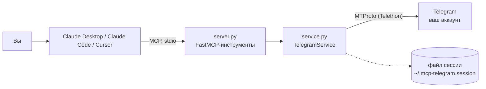

# mcp-telegram

MCP-сервер, который подключает ваш **личный аккаунт Telegram** к Claude Desktop, Claude Code или Cursor. Пригодится тем, кто тонет в чатах и хочет разбирать их через AI-ассистента.


## Зачем

За утро в Telegram набегают десятки сообщений в рабочих чатах, а нужное сообщение недельной давности приходится искать вручную. С этим сервером можно попросить ассистента обычными словами:

> «Что мне написали за утро? Суммаризируй рабочий чат.»
> «Найди сообщение, где Иван скидывал адрес офиса.»
> «Ответь Ивану, что буду в 15:00.»

Ассистент сам выберет нужный инструмент, а действие выполнит ваш аккаунт.

## Что умеет

- 📋 Показывает последние чаты, при желании только с непрочитанными сообщениями.
- 💬 Читает последние сообщения чата: по названию, `@username` или числовому id.
- 🔎 Ищет сообщения по тексту в одном чате или во всех сразу.
- ✉️ Отправляет текстовое сообщение, но только когда вы явно об этом попросили.
- Работает через MTProto от имени вашего аккаунта. Бот так не может: ему недоступны ваши личные чаты.

## Инструменты

| Инструмент | Что делает | Параметры (по умолчанию) |
|------------|------------|--------------------------|
| `list_chats` | Список последних чатов с типом (user / group / channel) и числом непрочитанных | `limit=20`, `unread_only=false` |
| `read_chat` | Последние сообщения чата, от старых к новым. Сообщения без текста пропускаются | `chat`, `limit=30` |
| `search` | Поиск по тексту. Пустой `chat` — поиск по всем чатам | `query`, `chat=""`, `limit=20` |
| `send_message` | Отправка текстового сообщения. В описании для модели сказано: «использовать, только если пользователь явно просит» | `chat`, `text` |

`chat` можно передать как название чата, `@username` или числовой id из `list_chats`.

## Схема



## Стек

- Python 3.10+
- [MCP Python SDK](https://github.com/modelcontextprotocol/python-sdk) (FastMCP, транспорт stdio)
- [Telethon](https://github.com/LonamiWebs/Telethon): клиент MTProto
- python-dotenv: настройки из `.env`
- pytest + pytest-asyncio: тесты

## Быстрый старт

**1. Получите ключи Telegram API** (один раз, пара минут).
Зайдите на [my.telegram.org](https://my.telegram.org) → API development tools → создайте приложение и скопируйте `api_id` и `api_hash`.

**2. Установите и войдите в аккаунт:**

```bash
git clone https://github.com/StepanCEO/mcp-telegram
cd mcp-telegram
python -m venv .venv
source .venv/bin/activate        # Windows: .venv\Scripts\activate
pip install -r requirements.txt
cp .env.example .env             # впишите TELEGRAM_API_ID и TELEGRAM_API_HASH
python -m mcp_telegram.login     # один раз: номер телефона, код из Telegram и пароль 2FA, если он включён
```

После входа появится файл сессии `~/.mcp-telegram.session`. Дальше сервер работает без участия человека.

**3. Подключите сервер к клиенту.**

Ниже `/путь/к/mcp-telegram` — это папка, куда вы клонировали репозиторий. `PYTHONPATH` нужен, чтобы `python -m mcp_telegram` нашёл пакет при запуске из любой директории. Файл `.env` из корня проекта подхватывается автоматически.

**Claude Desktop** — файл `claude_desktop_config.json`:

```json
{
  "mcpServers": {
    "telegram": {
      "command": "/путь/к/mcp-telegram/.venv/bin/python",
      "args": ["-m", "mcp_telegram"],
      "env": {
        "PYTHONPATH": "/путь/к/mcp-telegram"
      }
    }
  }
}
```

На Windows в `command` укажите `C:/путь/к/mcp-telegram/.venv/Scripts/python.exe`.

**Claude Code:**

```bash
claude mcp add telegram \
  -e PYTHONPATH=/путь/к/mcp-telegram \
  -- /путь/к/mcp-telegram/.venv/bin/python -m mcp_telegram
```

**Cursor** — файл `.cursor/mcp.json`, формат такой же, как у Claude Desktop.

Перезапустите клиент, и инструменты `telegram` появятся сами.

### Настройки (`.env`)

| Переменная | По умолчанию | Описание |
|------------|--------------|----------|
| `TELEGRAM_API_ID` | — | обязательно, с my.telegram.org |
| `TELEGRAM_API_HASH` | — | обязательно, с my.telegram.org |
| `TELEGRAM_SESSION` | `~/.mcp-telegram.session` | где хранить файл сессии |

## ⚠️ Безопасность

- **Файл сессии даёт полный доступ к вашему аккаунту Telegram.** Обращайтесь с ним как с паролем: никому не передавайте и не кладите в облако или репозиторий. Он хранится только на вашей машине, а в `.gitignore` уже исключены `*.session` и `.env`. Если файл утёк, завершите сессию в Telegram: Настройки → Устройства.
- **Переписка уходит в модель.** Всё, что прочитали инструменты, попадает в контекст AI-ассистента, а значит, к его провайдеру. Не открывайте ассистенту чаты с данными, которые нельзя передавать третьим лицам.
- **Подтверждайте отправку вручную.** MCP-клиенты обычно спрашивают разрешение перед вызовом инструмента. Не включайте для `send_message` автоматическое одобрение: в чужих сообщениях может оказаться текст, который попытается уговорить модель что-то отправить.
- Это ваш личный аккаунт, поэтому соблюдайте правила Telegram: никакого спама и массовых рассылок.

## Как устроено

```
mcp_telegram/
├── server.py     # MCP-инструменты (FastMCP, stdio), ленивое подключение по сохранённой сессии
├── service.py    # операции с Telegram и форматирование ответов (тестируемое ядро)
├── login.py      # одноразовый интерактивный вход, создаёт файл сессии
├── config.py     # чтение настроек из .env
└── __main__.py   # точка входа: python -m mcp_telegram
tests/
└── test_service.py   # тесты сервиса на фейковом клиенте Telethon
```

`service.py` получает клиента снаружи и ничего не знает о сети. Поэтому в тестах вместо Telethon подставляется заглушка с тем же интерфейсом.

## Тесты

```bash
pip install pytest pytest-asyncio
python -m pytest
```

Тесты не ходят в сеть и не требуют настоящего аккаунта: вместо Telethon используется фейковый клиент. Проверяются фильтр непрочитанных, порядок сообщений, поиск, отправка, разбор id чата и форматирование ответов.

## Лицензия

[MIT](LICENSE)

## Автор

**Степан** — fullstack и AI-разработчик
Портфолио: [stepanceo.github.io/Portfolio](https://stepanceo.github.io/Portfolio/) · Telegram: [@SStepCEO](https://t.me/SStepCEO)
